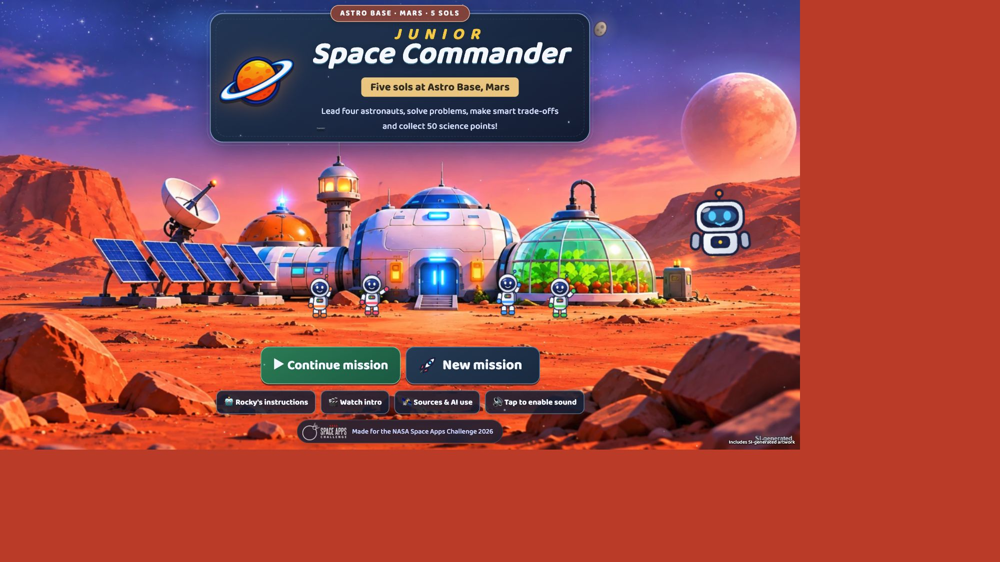
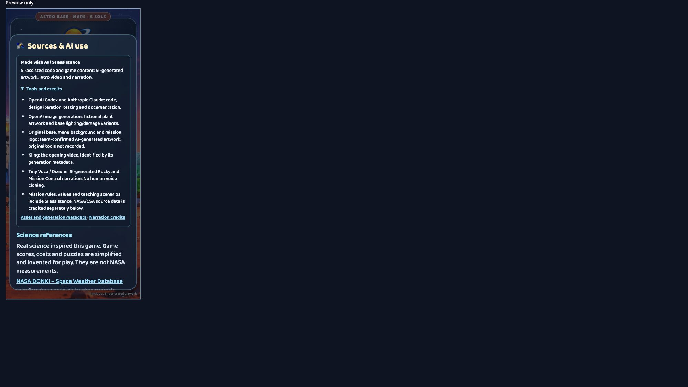
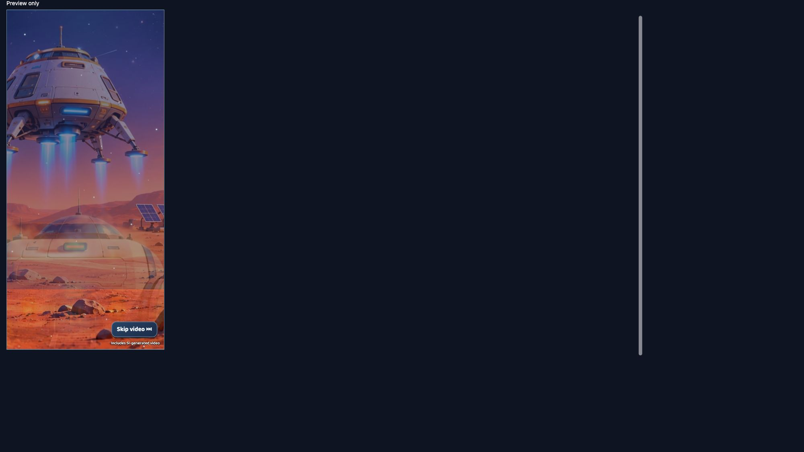
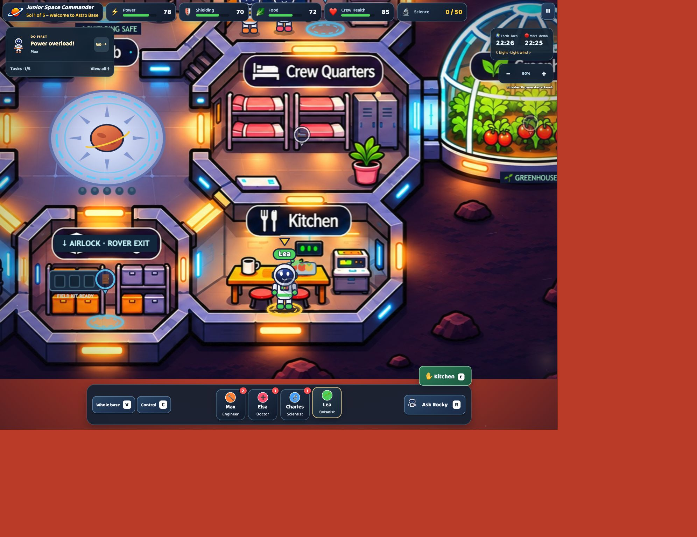
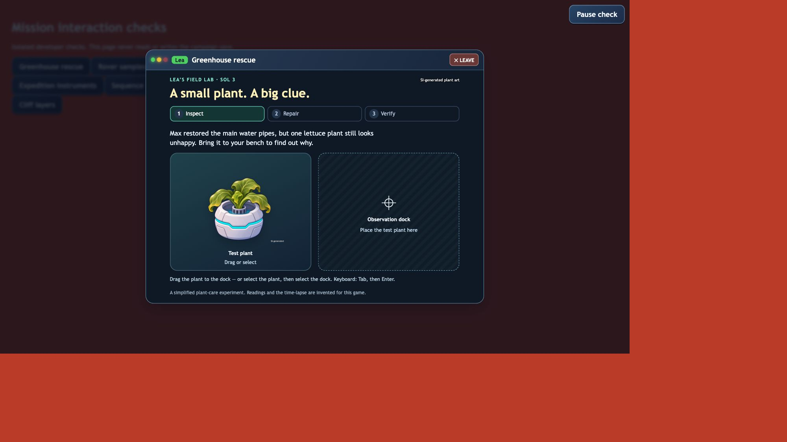

# SI disclosure changes — local review

**Reviewed and approved, then published on 15 November 2026 at 22:31 CET as Sites version 11.**

Live game: https://junior-space-commander.sentientstudios.chatgpt.site/

Published source: `58b27b78fddd09f062c055ab642134593a3bf884`. Live verification confirmed the updated credits, 10 px transparent notice and a 9 px gap below Skip.

This is a small disclosure pass using existing local tools. No paid generation, new artwork, voice generation, subscriptions or runtime AI services were added.

## What changed

| Requirement | Change |
| --- | --- |
| Explain where and how SI was used | Existing Data sources button is now **Sources & AI use**. A compact disclosure appears first; tool details expand only when opened. |
| Images: visible watermark | All **11 confirmed AI-generated images** have small **SI-generated** text at the bottom-right. It is plain white text with a thin dark outline, without a background box. |
| Video: visible watermark | The full intro has the same small embedded watermark. A small player notice stays readable when mobile framing crops the image. |
| Keep the game clean | The title-card badge was removed. The homepage notice says **Includes SI-generated artwork**, in 10 px text at the bottom-right, without a background. Station and greenhouse notices use the same small style. |
| Keep Skip clear | Skip sits above the player notice with a 9 px gap verified on desktop and a 390 px phone preview. Short phone menus can scroll so the disclosure does not make controls unreachable. |
| Audio: text and metadata | Credits identify SI-generated Tiny Voca / Dizione narration. All **310 MP3s** have embedded disclosure comments; voice manifest metadata identifies generation. Audio was not re-recorded or re-encoded. |
| Code/data: text and metadata | Codex and Claude are acknowledged in credits, documentation, HTML and package metadata, plus **public/SI-USE.json**. Fictional game values are distinguished from attributed NASA/CSA observations. |
| NASA branding | Reviewed all 11 stills and the intro’s continuous shot sampled at 4 fps. No obvious NASA logos, flags or mission identifiers appeared in those generated media. The separate Space Apps logo is unchanged and is not included in generated media. |

The original station background, menu background and mission logo were added to the disclosure after you confirmed their AI origin. Their specific generation tools were not recorded; the credits state that rather than inventing a provider. Kling is identified by the intro’s existing AIGC metadata. Selected plant and base variants are recorded as OpenAI image generation.

## What stayed the same

Missions, difficulty, scores, progression, saved-game format and Rocky’s behaviour are unchanged. There is no new gameplay AI feature. After your approval, the reviewed changes were pushed to the game’s Sites source repository and published. The local review record and original artwork backups remain available.

## Checks

- All 81 existing automated game checks passed.
- Production build passed; the local build includes the disclosures and refreshed source download.
- Phone credits checked at 390 px and 320 px: no horizontal overflow in the disclosure box, including expanded details.
- Desktop and phone visual checks covered the homepage, station, intro and greenhouse labels. The Skip overlap reported during review was corrected.
- Every MP3’s audio payload is byte-for-byte unchanged; metadata hashes and file sizes were refreshed.
- Intro dimensions (1916 × 1080), duration (5.041667 seconds), 121 frames, original AAC audio packets and Kling AIGC metadata are retained.
- Image dimensions and transparency outside watermark text are retained. Original files were used for the smaller-label revision, so the large labels were removed rather than covered up. Re-running the label scripts changes no files.
- Labelled image/video files together are about **5.63 MB smaller** than their originals; audio disclosure adds about **46 KiB**. No paid services or new dependencies were needed.

This records the implemented disclosures and visual inspection, not a certification from the challenge organizers.

## Local previews

[Open the local game](http://127.0.0.1:5882/) · [Read generation metadata](http://127.0.0.1:5882/SI-USE.json)

### Menu: small corner notice

### Credits: existing page, expandable tool details

### Intro: Skip above the notice, with a clear gap

### Station: smaller labels without a background

### Greenhouse: small text, no box

Media verification details and hashes are retained in [media-label-checks.json](si-disclosure/media-label-checks.json). The plain original media backups are outside the public folder at `/private/tmp/jsc-si-originals`; the previous committed assets also remain in Git history.

## Submission wording

Yes. OpenAI Codex and Anthropic Claude assisted code, fictional game content, design iteration, testing and documentation. OpenAI image generation produced selected plant and base variants. The original station/menu backgrounds and mission logo are also AI-generated; their original tools were not recorded. Kling generated the intro. Tiny Voca / Dizione generated prepared narration. Generated images/video carry visible SI-generated notices; audio credits and embedded metadata acknowledge SI generation. Code/data disclosures and asset provenance are available in Sources & AI use, project documentation and SI-USE.json. NASA/CSA science sources are credited separately; game values are fictional teaching models.
